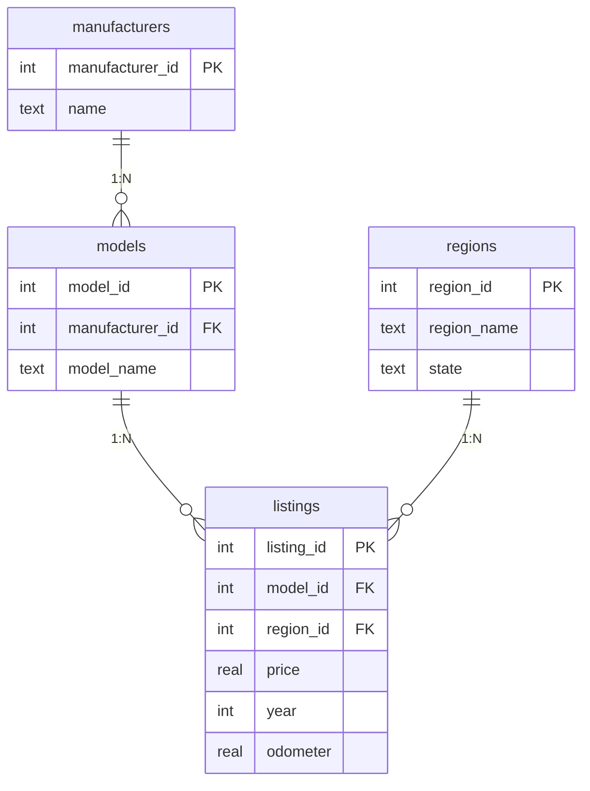

# Used Car Price Prediction — предсказание цены подержанных автомобилей

Итоговый проект.
Тема №35, Cluster 7 (Machine Learning on Tabular Data).

**Цель:** по характеристикам объявления (марка, модель, год, пробег, состояние и другие) предсказать цену
подержанного автомобиля и определить главные факторы цены.

**Авторы:** Нурай Кайратбеккызы, Жансая Асылбеккызы, Абылай Амандыков
## Данные

Craigslist Cars & Trucks, файл `vehicles.csv` (около 1,1 ГБ):
<https://www.kaggle.com/datasets/austinreese/craigslist-carstrucks-data>

Файл не хранится в репозитории из-за размера. Скачайте его и положите в `data/raw/vehicles.csv`
(или укажите путь: `python main.py --csv ПУТЬ`).

## Запуск

Нужен Python 3.12 или новее. Среда: консоль, VS Code, PyCharm или Google Colab.

```bash
pip install -r requirements.txt
python main.py --stage all                # весь пайплайн; подбор гиперпараметров занимает 15–20 минут
python -m unittest discover -s tests -v   # автотесты
python app_console.py                     # консольное меню
streamlit run app_streamlit.py            # веб-приложение: прогноз, фильтры, графики
```

Этапы (`--stage`): `prepare` → `clean` → `db` → `eda` → `train` → `report` → `presentation`.
Любой этап запускается отдельно, например `python main.py --stage train`.

Быстрая проверка без скачивания датасета (синтетические данные той же структуры, только чтобы убедиться,
что код работает):

```bash
python tests/make_synthetic_data.py data/synthetic/vehicles.csv
SMOKE=1 python main.py --stage all --csv data/synthetic/vehicles.csv
```

В Windows PowerShell вместо `SMOKE=1 python ...` выполните `$env:SMOKE=1`, затем `python ...`.
После такой проверки запустите `python main.py --stage all` на настоящих данных: результаты перезапишутся.

## Структура проекта

| Файл | Назначение |
|---|---|
| `main.py` | точка входа: запускает этапы по порядку |
| `config.py` | пути, пороги очистки, параметры обучения, состав команды |
| `data_loader.py` | чтение CSV по частям, оптимизация типов, Parquet, сравнение способов загрузки |
| `cleaning.py` | аудит качества данных и очистка с журналом шагов |
| `database.py` | схема SQLite, загрузка, выполнение запросов, ER-диаграмма, сравнение Pandas и SQL |
| `sql/queries.sql` | 11 SQL-запросов: JOIN, GROUP BY/HAVING, CTE, подзапросы, оконные функции |
| `eda.py` | описательная статистика и графики, включая интерактивный Plotly |
| `features.py` | производные признаки и `ColumnTransformer` |
| `modeling.py` | baseline, Ridge, HistGradientBoosting, LightGBM, подбор гиперпараметров, интервал цены |
| `interpretation.py` | Permutation Importance, график остатков, анализ ошибок |
| `predict.py` | сохранение и загрузка модели, проверка ввода, прогноз |
| `app_console.py`, `app_streamlit.py` | пользовательский интерфейс |
| `labels.py` | русские подписи значений в веб-приложении |
| `report_builder.py`, `build_presentation.py` | сборка отчёта и презентации из файлов результатов |
| `tests/` | автотесты и генератор синтетических данных для быстрой проверки |

## База данных



Картинка диаграммы: `outputs/figures/er_diagram.png`.

## Ключевые решения

* **Целевая переменная — log(1 + цена).** У цены тяжёлый правый хвост, логарифм стабилизирует обучение.
  Метрики MAE и RMSE считаются в долларах, после обратного преобразования.
* **Очистка.** Удаляются цены вне [500; 150 000], цены-заглушки (11111, 123456), год вне [1985; год публикации + 1],
  пробег больше 500 000 миль и строки, где цена совпадает с пробегом. Пробег меньше 100 миль у автомобиля
  старше года считается пропуском. Правило IQR считается справочно и не применяется: дорогие автомобили не ошибки.
* **Дубликаты.** Одно авто часто размещают повторно. Повторы по VIN и по совпадению года, марки, модели
  и точного пробега (второе правило — только для объявлений без VIN: разные VIN означают разные автомобили)
  удаляются до разбиения на выборки, иначе одно и то же авто попадёт и в train, и в test.
* **Защита от утечки данных.** Разбиение 80/20 выполняется до обучения преобразований. Импутация,
  масштабирование, One-Hot и целевое кодирование находятся внутри `Pipeline` и обучаются только на train.
* **Случайное разбиение.** Объявления опубликованы за один месяц, поэтому разбиение по времени не имеет смысла.
* **Выбор модели** делается по кросс-валидации на обучающей выборке; тест используется только для итоговой оценки.
* **Сравнение подходов:** способы загрузки (CSV, CSV по частям с оптимизацией типов, Parquet); Pandas и SQL
  на одной агрегации; модели (baseline, Ridge, HistGradientBoosting, LightGBM) по качеству, времени обучения,
  памяти, размеру и скорости предсказания.

## Расширение проекта: интервал цены

Кроме одного числа приложение показывает интервал цены. Его границы дают две модели квантильной регрессии,
а качество интервала проверяется на тесте (`outputs/results/interval_quality.json`). Пользователь может ввести
цену из объявления и узнать, ниже она рынка, выше или внутри интервала.

## Результаты

```
data/processed/   vehicles_raw.parquet, vehicles_clean.parquet, cars.db (не в репозитории, создаются запуском)
models/           best_model.joblib (не в репозитории), model_meta.json
outputs/results/  аудит, журнал очистки, сравнение моделей, важность признаков, анализ ошибок, результаты SQL
outputs/figures/  графики EDA, ER-диаграмма, остатки, важность признаков
outputs/report/   REPORT.md, REPORT.docx
presentation/     Used_Car_Price_Prediction.pptx
```

Отчёт и презентация собираются из файлов результатов, поэтому числа в них совпадают с последним запуском.
