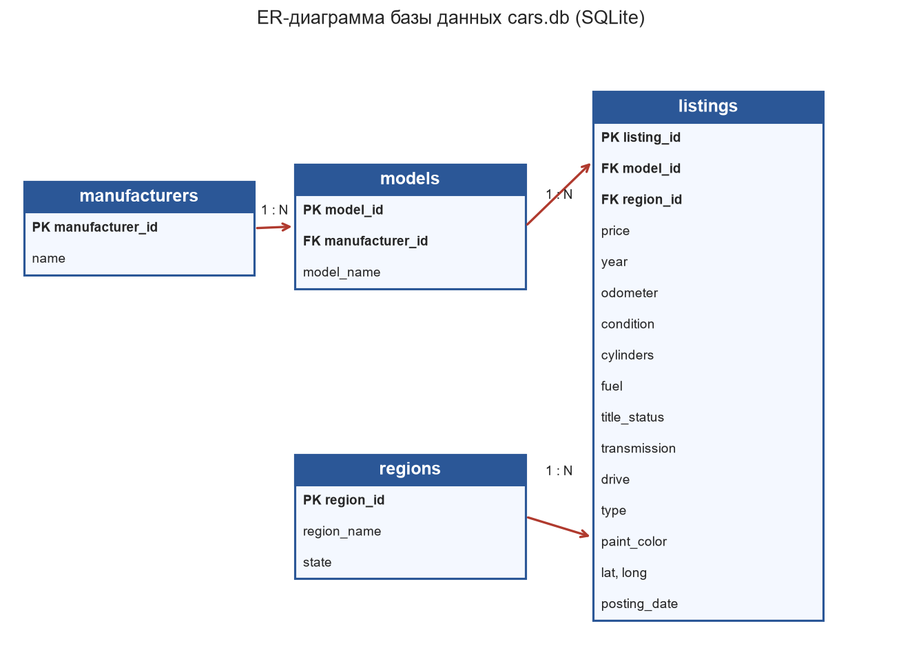
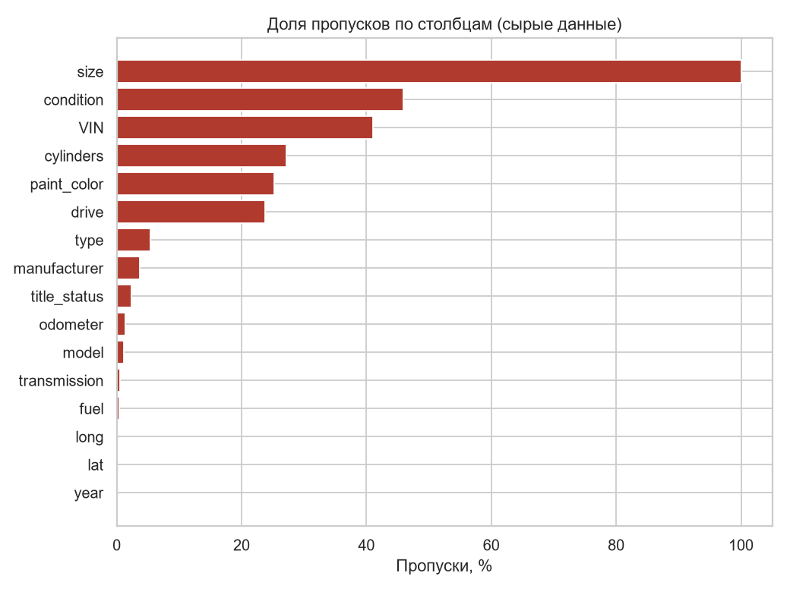
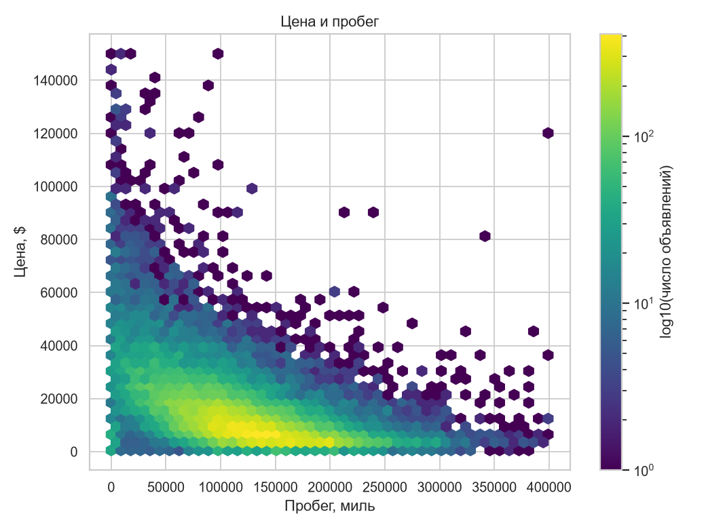
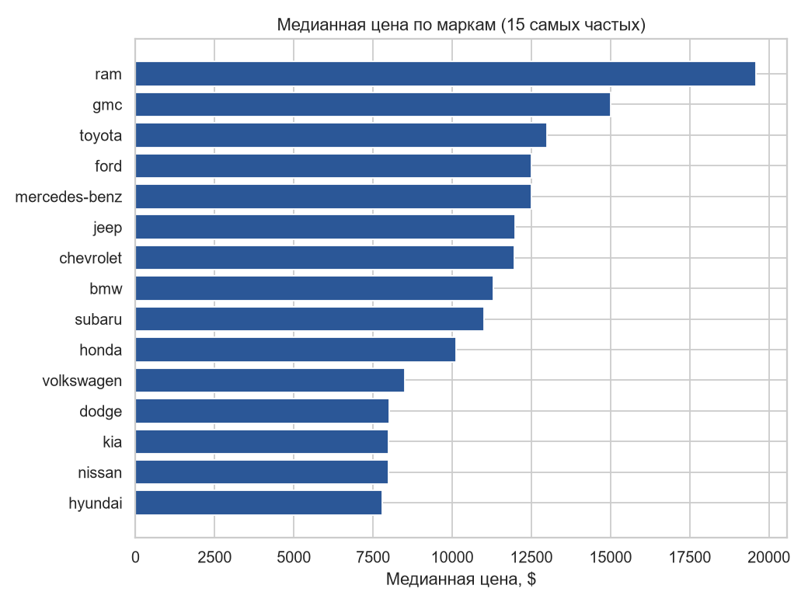
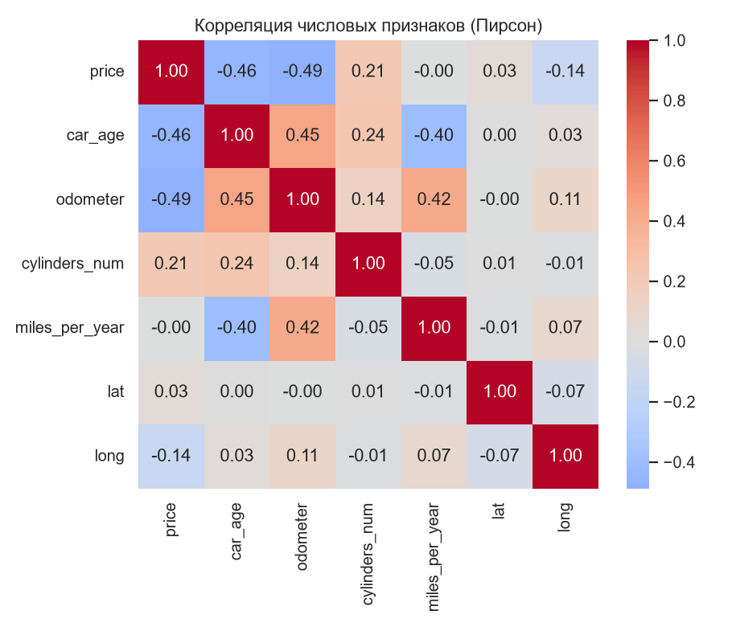
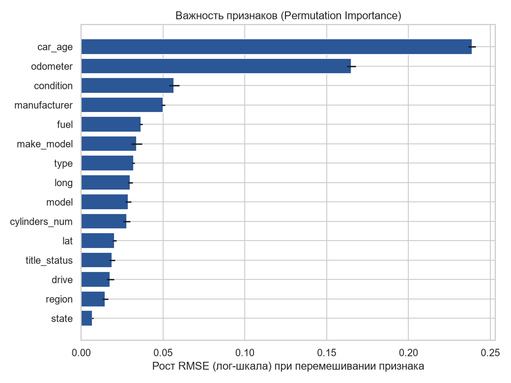

# Отчёт по итоговому проекту: предсказание стоимости подержанных автомобилей

**Дисциплина:** Programming for Data Analysis and Database (Applied Artificial Intelligence, магистратура). **Тема №35:** Used Car Price Prediction.

**Авторы:** Нурай Кайратбеккызы (AAI-2601); Жансая Асылбеккызы (AAI-2601); Абылай Амандыков (AAI-2601).

## 1. Постановка задачи

Требуется по характеристикам объявления (год, пробег, марка, модель, состояние, тип кузова, регион и др.) предсказать цену подержанного автомобиля и выявить факторы, сильнее всего влияющие на цену. Это задача регрессии. Качество измеряется средней абсолютной ошибкой (MAE, Mean Absolute Error) и среднеквадратичной ошибкой (RMSE, Root Mean Squared Error) в долларах; дополнительно приводятся R² и медианная абсолютная ошибка.

## 2. Данные

Источник: Craigslist Cars & Trucks (Kaggle, `austinreese/craigslist-carstrucks-data`). Целевая переменная — цена объявления `price`; модель обучается на log(1+price), так как распределение цены имеет тяжёлый правый хвост.

Загружено строк: **295,451**, столбцов в работе: 21. Период публикации объявлений: 2026-09-30 07:17:53 — 2026-11-03 04:41:25 (33 дн.).

Требование к объёму данных (не менее 500 тыс. строк или 200 МБ) выполнено по размеру файла: CSV занимает 1,110 МБ. Строк в текущей версии набора меньше 500 тыс., поэтому обработка построена так, как для большого файла: чтение по частям и Parquet.

Пропуски, % (10 столбцов с наибольшей долей):

| столбец | пропуски, % |
|---|---|
| size | 100.00 |
| condition | 45.86 |
| VIN | 40.99 |
| cylinders | 27.13 |
| paint_color | 25.29 |
| drive | 23.82 |
| type | 5.35 |
| manufacturer | 3.65 |
| title_status | 2.31 |
| odometer | 1.37 |

Некорректные значения до очистки:

| проверка | число строк |
|---|---|
| price_missing_or_leq_0 | 10288 |
| price_below_500 | 12653 |
| price_above_150000 | 680 |
| price_placeholder_values | 160 |
| odometer_negative | 0 |
| odometer_below_100 | 3520 |
| price_equals_odometer | 192 |
| odometer_above_500000 | 781 |
| year_outside_1985_2027 | 9734 |

Дубликаты: по корректному VIN — 83,165; полные (без id) — 64.

Справочно, границы выбросов цены по правилу IQR: [-18,250; 46,950], выбросов по этому правилу: 17,558. Правило IQR к цене не применялось (дорогие автомобили — не ошибки данных); применены доменные границы, см. раздел 4.

## 3. Загрузка данных и оптимизация памяти

Применены: чтение только нужных столбцов (`usecols`), чтение по частям (`chunksize`), понижение разрядности чисел (`downcast`), тип `category` для строк с малым числом значений, формат Parquet.

| Способ | Время чтения, с | DataFrame в памяти, МБ | Файл на диске, МБ |
|---|---|---|---|
| CSV: pandas.read_csv без оптимизации | 19.89 | 84.70 | 1,109.50 |
| CSV: chunksize + оптимизация типов | 18.43 | 22.80 | 1,109.50 |
| Parquet (после конвертации) | 0.64 | 22.80 | 9.80 |

Оба способа чтения CSV тратят почти одинаковое время: оно уходит на разбор текста, и чтение по частям его не сокращает. Выигрыш чанков и оптимизации типов — в памяти: числа хранятся в типах меньшей разрядности, а повторяющиеся строки — как категории. Parquet хранит данные по столбцам, в сжатом виде и с готовыми типами, поэтому читается во много раз быстрее; все следующие этапы работают с ним, а не с CSV.

## 4. Очистка данных

Правила (пороги заданы в `config.py`):

* цена вне [500; 150,000] и цены-заглушки (11111, 123456) удаляются: это «договорная цена», первый взнос или опечатка;
* год выпуска вне [1985; 2027] удаляется;
* пробег больше 500,000 миль удаляется, а пробег меньше 100 миль у автомобиля старше года считается пропуском (продавцы вписывают 0, 1 или 10 вместо настоящего значения);
* строки, где цена совпадает с пробегом, удаляются: одно число вписано в оба поля;
* повторные объявления удаляются до разбиения на выборки: сначала по VIN, затем по совпадению года, марки, модели и точного пробега. Из повторов остаётся самое свежее объявление;
* категории приводятся к нижнему регистру, пропуски заменяются на `unknown`.

Правило IQR к цене не применяется: оно отнесло бы к выбросам все дорогие автомобили, а это реальные объекты, а не ошибки.

| Правило | Удалено строк | Осталось строк |
|---|---|---|
| удалены строки без id, price или year (в т.ч. «сдвинутые» строки с текстом вместо числа) | 26 | 295425 |
| цена в диапазоне [500; 150000] | 13322 | 282103 |
| удалены цены-заглушки (11111, 123456 и т.п.) | 134 | 281969 |
| год в диапазоне [1985; 2027] | 9353 | 272616 |
| пробег в диапазоне [0; 500000] или пропуск | 460 | 272156 |
| пробег < 100 миль у авто старше 1 года -> пропуск (NaN): 947 значений | 0 | 272156 |
| удалены строки, где цена совпадает с пробегом (ошибка ввода) | 115 | 272041 |
| удалены повторы по корректному VIN (одно авто — несколько объявлений) | 79870 | 192171 |
| удалены повторы по году+марке+модели+точному пробегу (то же авто без VIN) | 27947 | 164224 |
| нижний регистр, strip, пропуски категорий -> 'unknown' | 0 | 164224 |

Итог: 164,224 строк, 9.1 МБ в памяти.

## 5. База данных SQLite и SQL-запросы

Схема в третьей нормальной форме: `manufacturers` → `models` → `listings` ← `regions`.

*Рисунок: ER-диаграмма базы данных.*

Число строк в таблицах: {'manufacturers': 43, 'models': 24199, 'regions': 412, 'listings': 164224}.

| query | desc | rows | seconds |
|---|---|---|---|
| q01_top_manufacturers | [JOIN x2, GROUP BY, HAVING] Топ-20 марок по числу объявлений, средняя цена и пробег | 20 | 0.163 |
| q02_price_by_year | [GROUP BY, HAVING] Средняя цена и пробег по году выпуска (кривая «обесценивания») | 43 | 0.334 |
| q03_state_price_rank | [JOIN, GROUP BY, HAVING, оконная функция RANK] Рейтинг штатов по средней цене | 50 | 0.095 |
| q04_model_premium | [CTE x2, JOIN x3] Модели, цена которых сильнее всего отличается от средней по марке | 20 | 1.444 |
| q05_top3_models_per_manufacturer | [CTE, оконная функция ROW_NUMBER с PARTITION BY] Три самые дорогие модели каждой марки | 90 | 0.602 |
| q06_overpriced_vs_model_average | [CTE, JOIN x3, GROUP BY] Число объявлений с ценой > 2.5 средних по своей модели, по маркам | 15 | 0.749 |
| q07_yoy_price_change | [CTE, оконная функция LAG] Изменение средней цены по сравнению с предыдущим годом выпуска | 43 | 0.358 |
| q08_body_type_share_by_fuel | [GROUP BY, HAVING, SUM() OVER PARTITION BY] Доля типов кузова внутри каждого вида топлива | 44 | 0.127 |
| q09_odometer_bucket_moving_avg | [CTE, оконная функция AVG OVER ROWS BETWEEN] Цена по корзинам пробега со скользящим средним | 12 | 0.087 |
| q10_regions_above_average | [JOIN, GROUP BY, HAVING + скалярный подзапрос] Регионы, где средняя цена выше средней по всей базе | 20 | 0.499 |
| q11_brand_pareto | [CTE, оконная функция SUM OVER (нарастающий итог)] Накопленная доля рынка по маркам | 25 | 0.062 |

Сравнение Pandas и SQL на одной задаче (средняя цена по маркам):

| method | seconds | result_rows |
|---|---|---|
| SQL (SQLite, JOIN + GROUP BY) | 0.1187 | 37 |
| Pandas (groupby) | 0.0060 | 37 |

Результаты запросов сохранены в `outputs/results/sql/` и использованы при построении графиков 08 и 09 (цена по году выпуска и по пробегу).

## 6. Исследовательский анализ данных (EDA)

Описательная статистика числовых признаков:

| признак | count | mean | std | min | 50% | max | skew |
|---|---|---|---|---|---|---|---|
| id | 164,224.00 | 7,986,824,463.73 | 5,367,276.28 | 7,975,321,065.00 | 7,987,723,957.50 | 7,994,391,213.00 | -0.41 |
| price | 164,224.00 | 15,299.95 | 14,242.68 | 500.00 | 11,000.00 | 150,000.00 | 2.74 |
| year | 164,224.00 | 2,013.68 | 7.40 | 1,985.00 | 2,015.00 | 2,027.00 | -0.93 |
| odometer | 160,771.00 | 118,306.74 | 62,276.78 | 1.00 | 114,838.00 | 500,000.00 | 0.63 |
| lat | 164,158.00 | 38.49 | 6.22 | -46.16 | 38.80 | 64.99 | -0.21 |
| long | 164,158.00 | -102.08 | 19.83 | -159.72 | -104.80 | 178.88 | -0.15 |
| cylinders_num | 120,870.00 | 5.66 | 1.61 | 3.00 | 6.00 | 12.00 | 0.39 |
| car_age | 164,224.00 | 12.32 | 7.40 | 0.00 | 11.00 | 41.00 | 0.93 |
| miles_per_year | 160,771.00 | 10,104.72 | 5,808.46 | 0.50 | 9,385.10 | 299,999.00 | 4.60 |

*Рисунок: Распределение цены и log(1+цена).*

*Рисунок: Доля пропусков по столбцам (сырые данные).*

*Рисунок: Выбросы цены и пробега до очистки.*

*Рисунок: Цена в зависимости от возраста.*

*Рисунок: Цена и пробег.*

*Рисунок: Медианная цена по маркам.*

*Рисунок: Корреляции числовых признаков.*

*Рисунок: Цена по категориальным признакам.*

*Рисунок: Средняя цена по году выпуска (результат SQL-запроса q02).*

*Рисунок: Цена по корзинам пробега (результат SQL-запроса q09).*

Интерактивный график: `outputs/figures/10_interactive_price_odometer.html` (открыть в браузере).

### Выводы по EDA (рассчитаны по данным)

- **Распределение цены.** Асимметрия цены равна 2.74; медиана $11,000, среднее $15,300, то есть распределение имеет тяжёлый правый хвост. После логарифмирования асимметрия равна -0.32, поэтому модель обучается на log(1+цена).
- **Связь цены с возрастом и пробегом.** Ранговая корреляция Спирмена цены с возрастом автомобиля -0.62, с пробегом -0.58; связь с возрастом сильнее.
- **Цена по возрасту.** Медианная цена по возрасту автомобиля (лет): 0–3 — $30,079; 4–7 — $19,980; 8–12 — $11,900; 13–20 — $6,781; >20 — $5,900.
- **Марки.** Среди 15 самых частых марок самая высокая медианная цена у ram ($19,583), самая низкая у hyundai ($7,800).
- **Цена по признаку «fuel».** Среди значений с n ≥ 500 наибольшая медианная цена у «other» ($25,146), наименьшая у «gas» ($10,000).
- **Цена по признаку «drive».** Среди значений с n ≥ 500 наибольшая медианная цена у «4wd» ($14,700), наименьшая у «fwd» ($8,195).
- **Цена по признаку «condition».** Среди значений с n ≥ 500 наибольшая медианная цена у «salvage» ($26,500), наименьшая у «fair» ($2,995).
- **Цена по признаку «type».** Среди значений с n ≥ 500 наибольшая медианная цена у «truck» ($19,758), наименьшая у «hatchback» ($7,735).
- **Пропуски.** Больше всего пропусков в сырых данных в столбцах: condition (45.9%), VIN (41.0%), cylinders (27.1%).
- **Выбросы.** В сырых данных 4.3% цен ниже $500 и 0.23% выше $150,000; эти значения вынесены за доменные границы и удалены при очистке (график 11).
- **Штаты (SQL q03).** По SQL-запросу q03 самая высокая средняя цена в штате hi ($21,862), самая низкая — в md ($7,940).
- **Концентрация по маркам (SQL q11).** На 14 самых частых марок приходится 80% объявлений с известной маркой.

### Интерпретация

Цена падает с возрастом и пробегом, потому что автомобиль изнашивается, у него заканчивается гарантия и сокращается оставшийся срок службы. Падение самое быстрое в первые годы, дальше кривая выравнивается: старый автомобиль дешевеет медленно. Возраст и пробег сильно связаны между собой, поэтому линейной модели трудно разделить их вклад.

Пикапы, грузовики, полный привод и дизель дороже остальных: такие автомобили дороже новыми и нужны для работы, поэтому дольше сохраняют цену.

Признак `condition` заполняет сам продавец, и он ненадёжен. Значение «salvage» должно означать автомобиль после серьёзной аварии, но медианная цена у этой группы высокая. Проверка показала, что так размечены в основном объявления дилеров коммерческих грузовиков (Ford F-550, Ram ProMaster) с чистыми документами. Поэтому в модели есть и `condition`, и `title_status`: второй признак точнее описывает юридическое состояние автомобиля.

## 7. Методы

* **Разбиение:** обучающая выборка 80% / тестовая 20%, `random_state=42`; разбиение выполняется до обучения любых преобразований.
* **Предобработка (`ColumnTransformer` в `Pipeline`):** числа — медианная импутация, индикаторы пропусков, стандартизация; категории с малым числом значений — One-Hot; категории с большим числом значений (марка, модель, марка+модель, регион) — целевое кодирование (`TargetEncoder`, кросс-фиттинг).
* **Модели:** baseline (медиана цены), линейная модель Ridge и два варианта градиентного бустинга: HistGradientBoosting (scikit-learn) и LightGBM.
* **Подбор гиперпараметров:** `RandomizedSearchCV`, 8 комбинаций, 3-блочная кросс-валидация на подвыборке обучающей выборки (60,000 объектов); итоговая модель обучается на всей обучающей выборке.
* **Выбор лучшей модели** — по CV-метрике (RMSE в лог-шкале) на обучающей выборке; тест используется один раз для итоговой оценки.
* **Защита от утечки данных:** повторы удалены до разбиения; все «обучаемые» преобразования находятся внутри Pipeline и обучаются только на обучающих данных.

Разбиение случайное, а не по времени: все объявления опубликованы за 33 дн., за такой срок рынок не меняется, и разбиение по дате не дало бы более честной оценки.

## 8. Результаты сравнения моделей

| model | cv_rmse_log | MAE | RMSE | R2 | tune_seconds | fit_seconds | peak_memory_mb | model_size_mb | predict_ms_per_1000 |
|---|---|---|---|---|---|---|---|---|---|
| baseline_median | 0.89 | 9,225.30 | 14,967.73 | -0.09 | 0.00 | 2.29 | 163.57 | 1.30 | 8.20 |
| ridge | 0.54 | 4,755.89 | 8,941.13 | 0.61 | 22.16 | 2.43 | 274.50 | 1.30 | 10.48 |
| hist_gb | 0.43 | 3,341.21 | 6,437.83 | 0.80 | 114.21 | 25.28 | 364.44 | 6.82 | 28.88 |
| lightgbm | 0.42 | 3,346.18 | 6,446.47 | 0.80 | 75.64 | 7.46 | 211.47 | 6.38 | 23.23 |

Обозначения: `cv_rmse_log` — RMSE кросс-валидации в лог-шкале; MAE, RMSE, R² — на тесте, в долларах; `peak_memory_mb` — пиковый прирост памяти процесса при обучении; `predict_ms_per_1000` — время предсказания для 1000 объектов, мс.

Гиперпараметры лучших моделей:

| model | best_params |
|---|---|
| baseline_median | {} |
| ridge | {'model__alpha': np.float64(8.471801418819979)} |
| hist_gb | {'model__max_leaf_nodes': 127, 'model__max_iter': 400, 'model__learning_rate': 0.05, 'model__l2_regularization': 0.0} |
| lightgbm | {'model__subsample': 0.9, 'model__num_leaves': 63, 'model__n_estimators': 900, 'model__min_child_samples': 20, 'model__learning_rate': 0.03, 'model__colsample_bytree': 0.7} |

## 9. Интерпретация и анализ ошибок

Важность признаков (Permutation Importance, топ-10):

| feature | importance | std |
|---|---|---|
| car_age | 0.2388 | 0.0022 |
| odometer | 0.1649 | 0.0027 |
| condition | 0.0568 | 0.0031 |
| manufacturer | 0.0500 | 0.0012 |
| fuel | 0.0366 | 0.0010 |
| make_model | 0.0339 | 0.0034 |
| type | 0.0319 | 0.0008 |
| long | 0.0299 | 0.0015 |
| model | 0.0286 | 0.0018 |
| cylinders_num | 0.0279 | 0.0021 |

*Рисунок: Важность признаков.*

*Рисунок: Факт vs прогноз, остатки и распределение ошибок.*

**Ошибки по ценовым диапазонам:**

| price_bin | n | MAE | MAPE_pct | bias |
|---|---|---|---|---|
| <5k | 6245 | 1,595.9 | 76.5 | 1,258.8 |
| 5–10k | 8835 | 1,751.9 | 23.7 | 231.5 |
| 10–20k | 9941 | 2,846.4 | 19.5 | -506.1 |
| 20–40k | 6074 | 4,975.0 | 17.9 | -2,080.0 |
| >40k | 1750 | 14,826.8 | 23.4 | -12,076.9 |

**Ошибки по возрасту автомобиля:**

| age_bin | n | MAE | MAPE_pct | bias |
|---|---|---|---|---|
| 0–3 | 3244 | 6,538.4 | 33.8 | -2,010.3 |
| 4–7 | 5588 | 4,173.0 | 28.5 | -803.5 |
| 8–12 | 10653 | 2,912.6 | 26.4 | -702.3 |
| 13–20 | 8908 | 2,275.0 | 31.8 | -577.6 |
| >20 | 4452 | 3,163.2 | 44.3 | -1,180.3 |

**Ошибки марки с наибольшей MAE (n ≥ 100):**

| manufacturer | n | MAE | MAPE_pct | bias |
|---|---|---|---|---|
| porsche | 193 | 9,438.1 | 88.1 | -4,091.8 |
| unknown | 1052 | 7,809.0 | 61.5 | -3,403.2 |
| rover | 265 | 5,414.3 | 26.7 | -2,096.7 |
| tesla | 203 | 5,276.2 | 18.1 | -2,544.5 |
| ram | 1322 | 4,743.8 | 25.2 | -1,622.0 |
| lexus | 635 | 4,382.8 | 41.6 | -3,705.5 |
| mercedes-benz | 1106 | 4,207.4 | 30.7 | -1,392.0 |
| cadillac | 409 | 4,144.2 | 51.5 | -2,026.1 |
| gmc | 1158 | 3,999.0 | 31.5 | -1,016.6 |
| audi | 580 | 3,821.4 | 39.5 | 1,869.7 |
| bmw | 1131 | 3,781.8 | 34.0 | 1,084.2 |
| ford | 5156 | 3,661.3 | 32.9 | -818.4 |
| jaguar | 104 | 3,619.9 | 35.2 | 735.6 |
| lincoln | 233 | 3,476.6 | 31.3 | -1,118.0 |
| chevrolet | 3687 | 3,451.8 | 31.9 | -922.3 |

**Ошибки 30 наибольших ошибок:**

| manufacturer | model | car_age | odometer | condition | price_true | price_pred | error |
|---|---|---|---|---|---|---|---|
| unknown | eliminator daytona | 8.0 | 250.0 | unknown | 145,699.0 | 17,830.0 | -127,869.0 |
| unknown | rolls-royce wraith star lights | 7.0 | 87,237.0 | excellent | 137,000.0 | 28,340.3 | -108,659.7 |
| unknown | stewart and stevenson m1078 | 28.0 | 1,480.0 | like new | 134,000.0 | 25,884.0 | -108,116.0 |
| chevrolet | silverado 1500 6.2l 4×4 fox factory | 1.0 | 581.0 | unknown | 139,000.0 | 31,747.0 | -107,253.0 |
| unknown | isuzu adventure & lifestyle vehicle | 19.0 | 78,000.0 | excellent | 125,000.0 | 19,339.6 | -105,660.4 |
| unknown | commercial lot | 0.0 | nan | unknown | 120,000.0 | 14,530.8 | -105,469.2 |
| unknown | bobcat t86 | 3.0 | nan | like new | 115,000.0 | 10,325.4 | -104,674.6 |
| rover | unknown | 2.0 | 10,457.0 | unknown | 149,995.0 | 50,026.6 | -99,968.4 |
| ford | shelby gt500 | 4.0 | 3,975.0 | like new | 135,000.0 | 41,382.8 | -93,617.2 |
| buick | enclave premium | 9.0 | 130,000.0 | excellent | 100,000.0 | 8,081.7 | -91,918.3 |
| unknown | international hv507 hv | 7.0 | 4,841.0 | excellent | 149,750.0 | 59,293.6 | -90,456.4 |
| chevrolet | corvette | 2.0 | 9,553.0 | unknown | 127,995.0 | 39,407.8 | -88,587.2 |
| porsche | 911 carrera g50 25th | 37.0 | 101,235.0 | good | 108,700.0 | 21,262.4 | -87,437.6 |
| unknown | mclaren 12c spider | 13.0 | 9,569.0 | excellent | 129,991.0 | 43,607.3 | -86,383.7 |
| aston-martin | martin vanquish volante | 10.0 | 14,035.0 | unknown | 123,995.0 | 38,360.4 | -85,634.6 |
| mitsubishi | fuso box truck camper | 19.0 | 215,000.0 | unknown | 90,000.0 | 8,455.3 | -81,544.7 |
| unknown | mclaren 570gt | 9.0 | 34,740.0 | unknown | 134,991.0 | 53,914.7 | -81,076.3 |
| tesla | model s | 0.0 | 12,735.0 | unknown | 139,900.0 | 59,147.8 | -80,752.2 |
| nissan | gtr black edition | 12.0 | 53,572.0 | excellent | 99,700.0 | 19,528.9 | -80,171.1 |
| unknown | freightliner sportchassis rha114 | 13.0 | 129,037.0 | unknown | 99,875.0 | 20,416.7 | -79,458.3 |
| ferrari | unknown | 16.0 | 8,164.0 | like new | 110,000.0 | 32,147.5 | -77,852.5 |
| unknown | kennworth t680 | 2.0 | 100,000.0 | excellent | 150,000.0 | 72,277.3 | -77,722.7 |
| mercedes-benz | unknown | 3.0 | 12,900.0 | like new | 129,900.0 | 53,036.0 | -76,864.0 |
| unknown | mercees  benz gwagon  2021 | 5.0 | 17,580.0 | like new | 130,000.0 | 56,384.6 | -73,615.4 |
| mercedes-benz | sprinter 2500 | 7.0 | 76,000.0 | excellent | 105,000.0 | 34,334.8 | -70,665.2 |
| unknown | lamborghini gallardo | 19.0 | 26,373.0 | unknown | 124,950.0 | 54,712.1 | -70,237.9 |
| tesla | model x plaid sport utility 4d | 0.0 | 16,216.0 | unknown | 149,950.0 | 80,975.0 | -68,975.0 |
| unknown | workhourse | 14.0 | 112,000.0 | excellent | 90,000.0 | 21,092.2 | -68,907.8 |
| unknown | isuzu npr/npr-hd | 7.0 | 83,841.0 | good | 95,000.0 | 26,627.7 | -68,372.3 |
| unknown | peterbilt 337 | 4.0 | 394,765.0 | unknown | 120,000.0 | 52,575.5 | -67,424.5 |

### Автоматически сформированные выводы (на основе таблиц выше)

- **Лучшая модель.** По кросс-валидации лучшей оказалась модель lightgbm: на тесте MAE = $3,346, RMSE = $6,446, R² = 0.797. Baseline (медиана) даёт MAE = $9,225, то есть улучшение по MAE составляет 63.7%.
- **Выбор по CV и по тесту.** Наименьшую MAE на тесте показала модель hist_gb ($3,341), но выбор делался по CV (lightgbm), чтобы не подгонять модель под тест.
- **Линейная модель и ансамбли.** Лучшая нелинейная модель (hist_gb) снизила MAE относительно линейной Ridge на 29.7% ($3,341 против $4,756).
- **Время и размер.** Быстрее всех обучилась ridge (2.4 с), дольше всех — hist_gb (25.3 с). Самая тяжёлая модель по размеру файла — hist_gb (6.8 МБ).
- **Обоснование выбора.** Модели, у которых MAE не более чем на 2% хуже лучшей (hist_gb, lightgbm), близки по качеству; среди них быстрее всех обучается lightgbm (7.5 с), компактнее всех — lightgbm (6.4 МБ), быстрее всех предсказывает lightgbm (23 мс на 1000 объявлений). Поэтому выбор между ними определяется требованиями к скорости и размеру, а не только качеством.
- **Главные факторы цены.** Наибольшее влияние на прогноз оказывают признаки: car_age (0.239), odometer (0.165), condition (0.057). Вместе они дают 58% суммарной положительной важности (рост RMSE в лог-шкале при перемешивании признака).
- **Ошибки по цене.** Наибольшая относительная ошибка (MAPE) — в ценовом диапазоне «<5k» (77%), наибольшая абсолютная (MAE) — в диапазоне «>40k» ($14,827).
- **Смещение: <5k.** В диапазоне «<5k» модель в среднем завышает цену на $1,259.
- **Смещение: 5–10k.** В диапазоне «5–10k» модель в среднем завышает цену на $232.
- **Смещение: 10–20k.** В диапазоне «10–20k» модель в среднем занижает цену на $506.
- **Смещение: 20–40k.** В диапазоне «20–40k» модель в среднем занижает цену на $2,080.
- **Смещение: >40k.** В диапазоне «>40k» модель в среднем занижает цену на $12,077.
- **Ошибки по возрасту.** Наибольшая относительная ошибка — для автомобилей возраста «>20» лет (44%, n = 4452).
- **Ошибки по маркам.** Среди марок с n ≥ 100 наибольшая MAE у porsche ($9,438, n = 193).
- **Интервал цены.** Интервал квантильной регрессии должен накрывать 80% объявлений; на тесте внутри него оказалось 77.8% (ниже интервала 11.0%, выше 11.2%). Медианная ширина интервала — $7,410 (69% от цены автомобиля).

### Почему модель ошибается

**Дорогие автомобили занижаются.** Причин три. Первая: дорогих объявлений мало, и модель тянет прогноз к типичной цене. Вторая: модель обучается на логарифме цены, а обратное преобразование даёт оценку ближе к медиане, чем к среднему, то есть ниже для распределения с правым хвостом. Третья: цену таких автомобилей определяют комплектация и редкие версии (например, Dodge Demon 170 или Mercedes G-класса), а в данных есть только марка и название модели.

**Дешёвые автомобили завышаются.** У автомобиля дешевле $5,000 обычно есть дефекты, которые продавец описывает в тексте объявления, а не в полях. Кроме того, часть дилеров указывает в поле цены первый взнос, а не полную стоимость.

**Старые автомобили.** Среди автомобилей старше 20 лет есть и коллекционные, и доживающие свой срок. По году и пробегу они неразличимы, а цены отличаются в разы.

**Важность координат.** Координаты объявления входят в десятку самых важных признаков: цены различаются по регионам (в сельских штатах больше пикапов и выше средняя цена), и координаты описывают место точнее, чем название штата.

**Самые большие ошибки** приходятся на коммерческую технику и на объявления с ошибкой в цене. Это видно в таблице худших прогнозов: модель предсказывает обычную цену для своей марки, а в объявлении стоит цена в несколько раз выше.

## 10. Прогноз и интервал цены

Прогноз выполняется сохранённой обученной моделью (`models/best_model.joblib`): консольное меню `python app_console.py` (пункт 7) или веб-интерфейс `streamlit run app_streamlit.py`. Обязателен только год выпуска; пробег, координаты и категории можно не указывать (пробег заменяется медианой обучающей выборки, категории — `unknown`). Некорректный ввод (текст вместо числа, год или пробег вне допустимого диапазона) отклоняется с понятным сообщением.

Сохранённая модель: **lightgbm**, обучена 2026-11-16T01:02:02; метрики на тесте: MAE $3,346, RMSE $6,446, R² 0.797.

**Расширение проекта: интервал цены.** Одно число создаёт ложное ощущение точности, поэтому вместе с прогнозом приложение показывает интервал. Его границы дают две модели квантильной регрессии (HistGradientBoosting с квантилями 0.1 и 0.9), обученные на той же обучающей выборке. Если пользователь вводит цену из объявления, приложение сообщает, ниже она рынка, выше или внутри интервала.

Проверка на тесте: интервал должен накрывать 80% объявлений, фактически внутри него 77.8% (ниже 11.0%, выше 11.2%). Медианная ширина — $7,410, или 69% от цены. Интервал широкий: это честная мера того, насколько цену объявления можно предсказать по имеющимся признакам.

## 11. Ограничения

* Цены в объявлениях — это цены предложения, а не фактические цены сделок.
* Повторные объявления удалены до разбиения, но полностью исключить утечку нельзя: продавец может разместить то же авто повторно, изменив пробег.
* В данных нет информации о состоянии кузова, комплектации, истории обслуживания и фотографиях.
* Пороги очистки (config.py) выбраны экспертно и влияют на метрики.
* Подбор гиперпараметров выполнен на подвыборке обучающей выборки ради времени вычислений.
* Прогноз для редких моделей опирается на сглаженное целевое кодирование и менее надёжен.

## 12. Выводы

- По кросс-валидации лучшей оказалась модель lightgbm: на тесте MAE = $3,346, RMSE = $6,446, R² = 0.797. Baseline (медиана) даёт MAE = $9,225, то есть улучшение по MAE составляет 63.7%.
- Наименьшую MAE на тесте показала модель hist_gb ($3,341), но выбор делался по CV (lightgbm), чтобы не подгонять модель под тест.
- Лучшая нелинейная модель (hist_gb) снизила MAE относительно линейной Ridge на 29.7% ($3,341 против $4,756).
- Быстрее всех обучилась ridge (2.4 с), дольше всех — hist_gb (25.3 с). Самая тяжёлая модель по размеру файла — hist_gb (6.8 МБ).

**Итог.** Цену объявления удаётся предсказать со средней ошибкой $3,346 против $9,225 у baseline; половина прогнозов ошибается меньше чем на $1,848. Градиентный бустинг заметно точнее линейной модели, потому что цена зависит от возраста и пробега нелинейно, а влияние признаков различается для разных марок. Главные факторы цены — возраст и пробег. Модель подходит для быстрой оценки массовых автомобилей среднего ценового диапазона; для дорогих, редких и очень старых автомобилей её прогноз следует считать ориентиром, и приложение показывает это шириной интервала.

## 13. Вклад участников

| Участник | Группа | Вклад |
|---|---|---|
| Нурай Кайратбеккызы | AAI-2601 | анализ и интерфейс: eda.py, app_console.py, app_streamlit.py, тесты, отчёт и презентация |
| Жансая Асылбеккызы | AAI-2601 | данные и база: data_loader.py, cleaning.py, database.py, sql/queries.sql (загрузка, Parquet, аудит и очистка, схема SQLite, SQL-запросы) |
| Абылай Амандыков | AAI-2601 | модели: features.py, modeling.py, interpretation.py, predict.py (признаки, обучение и сравнение моделей, интервал цены, анализ ошибок) |

Итоговая проверка проекта и подготовка к защите выполнены совместно.

## 14. Воспроизводимость

Версии при обучении: {'python': '3.13.2', 'scikit-learn': '1.9.1', 'pandas': '3.0.6'}.

Запуск: `pip install -r requirements.txt`, затем `python main.py --stage all`. Манифест запуска со списком созданных файлов: `outputs/run_manifest.json`.

## 15. Источники
* Craigslist Cars & Trucks Data, Kaggle: https://www.kaggle.com/datasets/austinreese/craigslist-carstrucks-data
* Документация scikit-learn (Pipeline, TargetEncoder, HistGradientBoostingRegressor, permutation_importance): https://scikit-learn.org/stable/
* Документация LightGBM: https://lightgbm.readthedocs.io/
* Документация pandas, SQLite (оконные функции), Plotly, Streamlit.
