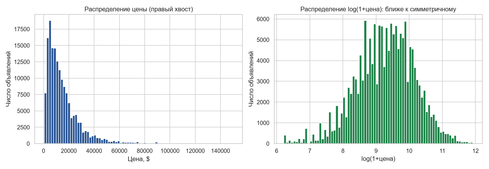
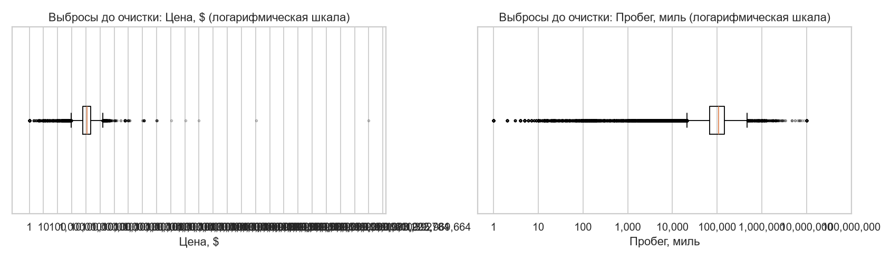
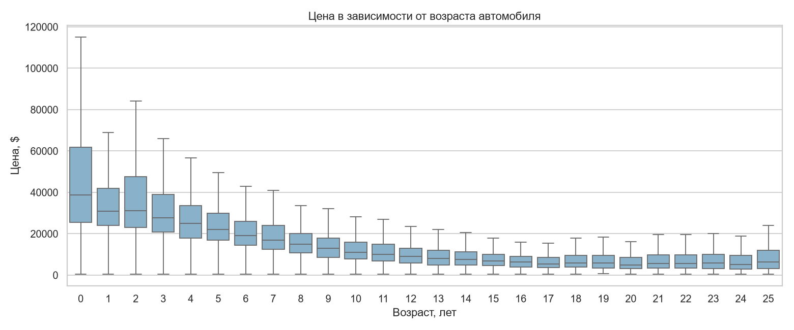
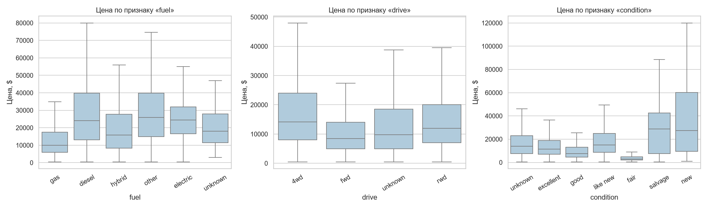
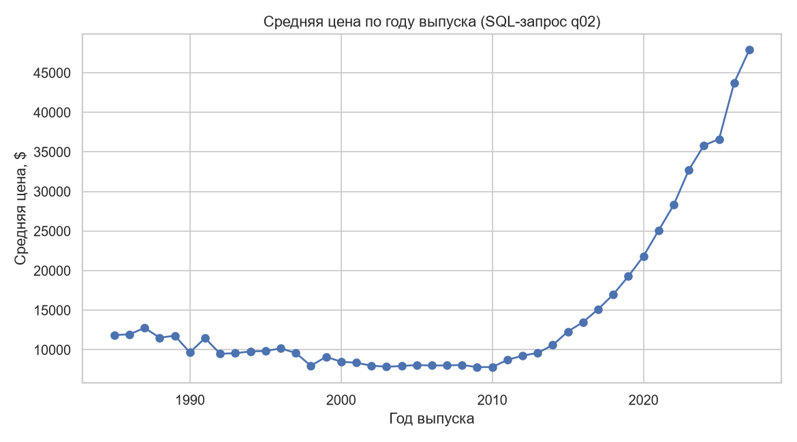
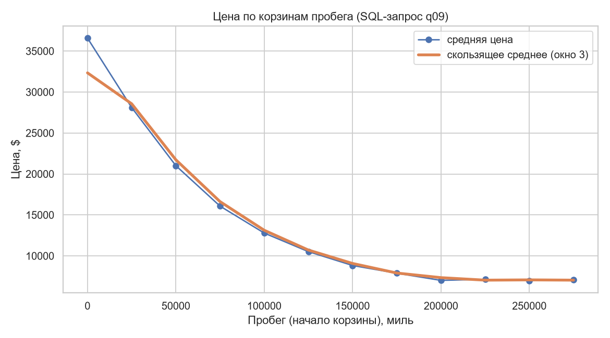
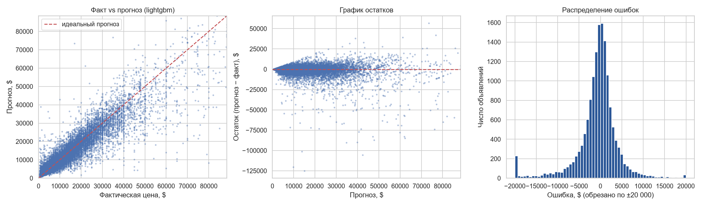

# Отчёт по итоговому проекту: предсказание стоимости подержанных автомобилей

**Дисциплина:** Programming for Data Analysis and Database (Applied Artificial Intelligence, магистратура). **Тема №35:** Used Car Price Prediction.

**Авторы:** Нурай Кайратбеккызы (AAI-2601); Жансая Асылбеккызы (AAI-2601); Абылай Амандыков (AAI-2601).

## 1. Постановка задачи

Требуется по характеристикам объявления (год, пробег, марка, модель, состояние, тип кузова, регион и др.) предсказать цену подержанного автомобиля и выявить факторы, сильнее всего влияющие на цену. Это задача регрессии. Качество измеряется средней абсолютной ошибкой (MAE, Mean Absolute Error) и среднеквадратичной ошибкой (RMSE, Root Mean Squared Error) в долларах; дополнительно приводятся R² и медианная абсолютная ошибка.

## 2. Данные

Источник: Craigslist Cars & Trucks (Kaggle, `austinreese/craigslist-carstrucks-data`). Целевая переменная — цена объявления `price`; модель обучается на log(1+price), так как распределение цены имеет тяжёлый правый хвост.

Загружено строк: **295,451**, столбцов в работе: 21. Период публикации объявлений: 2026-09-30 07:17:53 — 2026-11-03 04:41:25 (33 дн.).

Требование к объёму данных (не менее 500 тыс. строк или 200 МБ) выполнено по размеру файла: CSV занимает 1,110 МБ. Строк в текущей версии набора меньше 500 тыс., поэтому обработка построена так, как для большого файла: чтение по частям и Parquet.

Пропуски, % (10 столбцов с наибольшей долей):

| столбец | пропуски, % |
|---|---|
| size | 100.00 |
| condition | 45.86 |
| VIN | 40.99 |
| cylinders | 27.13 |
| paint_color | 25.29 |
| drive | 23.82 |
| type | 5.35 |
| manufacturer | 3.65 |
| title_status | 2.31 |
| odometer | 1.37 |

Некорректные значения до очистки:

| проверка | число строк |
|---|---|
| price_missing_or_leq_0 | 10288 |
| price_below_500 | 12653 |
| price_above_150000 | 680 |
| price_placeholder_values | 160 |
| odometer_negative | 0 |
| odometer_below_100 | 3520 |
| price_equals_odometer | 192 |
| odometer_above_500000 | 781 |
| year_outside_1985_2027 | 9734 |

Дубликаты: по корректному VIN — 83,165; полные (без id) — 64.

Справочно, границы выбросов цены по правилу IQR: [-18,250; 46,950], выбросов по этому правилу: 17,558. Правило IQR к цене не применялось (дорогие автомобили — не ошибки данных); применены доменные границы, см. раздел 4.

## 3. Загрузка данных и оптимизация памяти

Применены: чтение только нужных столбцов (`usecols`), чтение по частям (`chunksize`), понижение разрядности чисел (`downcast`), тип `category` для строк с малым числом значений, формат Parquet.

| Способ | Время чтения, с | DataFrame в памяти, МБ | Файл на диске, МБ |
|---|---|---|---|
| CSV: pandas.read_csv без оптимизации | 19.89 | 84.70 | 1,109.50 |
| CSV: chunksize + оптимизация типов | 18.43 | 22.80 | 1,109.50 |
| Parquet (после конвертации) | 0.64 | 22.80 | 9.80 |

Оба способа чтения CSV тратят почти одинаковое время: оно уходит на разбор текста, и чтение по частям его не сокращает. Выигрыш чанков и оптимизации типов — в памяти: числа хранятся в типах меньшей разрядности, а повторяющиеся строки — как категории. Parquet хранит данные по столбцам, в сжатом виде и с готовыми типами, поэтому читается во много раз быстрее; все следующие этапы работают с ним, а не с CSV.

## 4. Очистка данных

Правила (пороги заданы в `config.py`):

* цена вне [500; 150,000] и цены-заглушки (11111, 123456) удаляются: это «договорная цена», первый взнос или опечатка;
* год выпуска вне [1985; 2027] удаляется;
* пробег больше 500,000 миль удаляется, а пробег меньше 100 миль у автомобиля старше года считается пропуском (продавцы вписывают 0, 1 или 10 вместо настоящего значения);
* строки, где цена совпадает с пробегом, удаляются: одно число вписано в оба поля;
* повторные объявления удаляются до разбиения на выборки: сначала по VIN, затем по совпадению года, марки, модели и точного пробега (только объявления без VIN: разные VIN означают разные автомобили). Из повторов остаётся объявление с VIN, а если его нет — самое свежее;
* категории приводятся к нижнему регистру, пропуски заменяются на `unknown`.

Правило IQR к цене не применяется: оно отнесло бы к выбросам все дорогие автомобили, а это реальные объекты, а не ошибки.

| Правило | Удалено строк | Осталось строк |
|---|---|---|
| удалены строки без id, price или year (в т.ч. «сдвинутые» строки с текстом вместо числа) | 26 | 295425 |
| цена в диапазоне [500; 150000] | 13322 | 282103 |
| удалены цены-заглушки (11111, 123456 и т.п.) | 134 | 281969 |
| год в диапазоне [1985; 2027] | 9353 | 272616 |
| пробег в диапазоне [0; 500000] или пропуск | 460 | 272156 |
| пробег < 100 миль у авто старше 1 года -> пропуск (NaN): 947 значений | 0 | 272156 |
| удалены строки, где цена совпадает с пробегом (ошибка ввода) | 115 | 272041 |
| удалены повторы по корректному VIN (одно авто — несколько объявлений) | 79870 | 192171 |
| удалены объявления без VIN, повторяющие год+марку+модель+точный пробег другого объявления (то же авто) | 27688 | 164483 |
| нижний регистр, strip, пропуски категорий -> 'unknown' | 0 | 164483 |

Итог: 164,483 строк, 9.1 МБ в памяти.

## 5. База данных SQLite и SQL-запросы

Схема в третьей нормальной форме: `manufacturers` → `models` → `listings` ← `regions`.

*Рисунок: ER-диаграмма базы данных.*

Число строк в таблицах: {'manufacturers': 43, 'models': 24199, 'regions': 412, 'listings': 164483}.

| query | desc | rows | seconds |
|---|---|---|---|
| q01_top_manufacturers | [JOIN x2, GROUP BY, HAVING] Топ-20 марок по числу объявлений, средняя цена и пробег | 20 | 0.158 |
| q02_price_by_year | [GROUP BY, HAVING] Средняя цена и пробег по году выпуска (кривая «обесценивания») | 43 | 0.373 |
| q03_state_price_rank | [JOIN, GROUP BY, HAVING, оконная функция RANK] Рейтинг штатов по средней цене | 50 | 0.106 |
| q04_model_premium | [CTE x2, JOIN x3] Модели, цена которых сильнее всего отличается от средней по марке | 20 | 1.556 |
| q05_top3_models_per_manufacturer | [CTE, оконная функция ROW_NUMBER с PARTITION BY] Три самые дорогие модели каждой марки | 90 | 0.802 |
| q06_overpriced_vs_model_average | [CTE, JOIN x3, GROUP BY] Число объявлений с ценой > 2.5 средних по своей модели, по маркам | 15 | 0.958 |
| q07_yoy_price_change | [CTE, оконная функция LAG] Изменение средней цены по сравнению с предыдущим годом выпуска | 43 | 0.392 |
| q08_body_type_share_by_fuel | [GROUP BY, HAVING, SUM() OVER PARTITION BY] Доля типов кузова внутри каждого вида топлива | 44 | 0.133 |
| q09_odometer_bucket_moving_avg | [CTE, оконная функция AVG OVER ROWS BETWEEN] Цена по корзинам пробега со скользящим средним | 12 | 0.088 |
| q10_regions_above_average | [JOIN, GROUP BY, HAVING + скалярный подзапрос] Регионы, где средняя цена выше средней по всей базе | 20 | 0.413 |
| q11_brand_pareto | [CTE, оконная функция SUM OVER (нарастающий итог)] Накопленная доля рынка по маркам | 25 | 0.059 |

Сравнение Pandas и SQL на одной задаче (средняя цена по маркам):

| method | seconds | result_rows |
|---|---|---|
| SQL (SQLite, JOIN + GROUP BY) | 0.1166 | 37 |
| Pandas (groupby) | 0.0084 | 37 |

Результаты запросов сохранены в `outputs/results/sql/` и использованы при построении графиков 08 и 09 (цена по году выпуска и по пробегу).

## 6. Исследовательский анализ данных (EDA)

Описательная статистика числовых признаков:

| признак | count | mean | std | min | 50% | max | skew |
|---|---|---|---|---|---|---|---|
| id | 164,483.00 | 7,986,814,421.12 | 5,369,327.70 | 7,975,321,065.00 | 7,987,709,331.00 | 7,994,391,213.00 | -0.41 |
| price | 164,483.00 | 15,345.89 | 14,333.03 | 500.00 | 11,000.00 | 150,000.00 | 2.74 |
| year | 164,483.00 | 2,013.70 | 7.40 | 1,985.00 | 2,015.00 | 2,027.00 | -0.93 |
| odometer | 161,030.00 | 118,173.61 | 62,361.25 | 1.00 | 114,732.50 | 500,000.00 | 0.62 |
| lat | 164,417.00 | 38.50 | 6.23 | -46.16 | 38.80 | 64.99 | -0.20 |
| long | 164,417.00 | -102.09 | 19.84 | -159.72 | -104.80 | 178.88 | -0.16 |
| cylinders_num | 121,106.00 | 5.66 | 1.61 | 3.00 | 6.00 | 12.00 | 0.40 |
| car_age | 164,483.00 | 12.30 | 7.40 | 0.00 | 11.00 | 41.00 | 0.93 |
| miles_per_year | 161,030.00 | 10,093.62 | 5,814.30 | 0.50 | 9,380.82 | 299,999.00 | 4.57 |

*Рисунок: Распределение цены и log(1+цена).*

*Рисунок: Доля пропусков по столбцам (сырые данные).*

*Рисунок: Выбросы цены и пробега до очистки.*

*Рисунок: Цена в зависимости от возраста.*

*Рисунок: Цена и пробег.*

*Рисунок: Медианная цена по маркам.*

*Рисунок: Корреляции числовых признаков.*

*Рисунок: Цена по категориальным признакам.*

*Рисунок: Средняя цена по году выпуска (результат SQL-запроса q02).*

*Рисунок: Цена по корзинам пробега (результат SQL-запроса q09).*

Интерактивный график: `outputs/figures/10_interactive_price_odometer.html` (открыть в браузере).

### Выводы по EDA (рассчитаны по данным)

- **Распределение цены.** Асимметрия цены равна 2.74; медиана $11,000, среднее $15,346, то есть распределение имеет тяжёлый правый хвост. После логарифмирования асимметрия равна -0.32, поэтому модель обучается на log(1+цена).
- **Связь цены с возрастом и пробегом.** Ранговая корреляция Спирмена цены с возрастом автомобиля -0.62, с пробегом -0.58; связь с возрастом сильнее.
- **Цена по возрасту.** Медианная цена по возрасту автомобиля (лет): 0–3 — $30,410; 4–7 — $19,980; 8–12 — $11,900; 13–20 — $6,787; >20 — $5,900.
- **Марки.** Среди 15 самых частых марок самая высокая медианная цена у ram ($19,588), самая низкая у hyundai ($7,800).
- **Цена по признаку «fuel».** Среди значений с n ≥ 500 наибольшая медианная цена у «other» ($25,053), наименьшая у «gas» ($10,000).
- **Цена по признаку «drive».** Среди значений с n ≥ 500 наибольшая медианная цена у «4wd» ($14,750), наименьшая у «fwd» ($8,195).
- **Цена по признаку «condition».** Среди значений с n ≥ 500 наибольшая медианная цена у «salvage» ($26,500), наименьшая у «fair» ($2,995).
- **Цена по признаку «type».** Среди значений с n ≥ 500 наибольшая медианная цена у «truck» ($19,778), наименьшая у «hatchback» ($7,750).
- **Пропуски.** Больше всего пропусков в сырых данных в столбцах: condition (45.9%), VIN (41.0%), cylinders (27.1%).
- **Выбросы.** В сырых данных 4.3% цен ниже $500 и 0.23% выше $150,000; эти значения вынесены за доменные границы и удалены при очистке (график 11).
- **Штаты (SQL q03).** По SQL-запросу q03 самая высокая средняя цена в штате ak ($22,273), самая низкая — в md ($7,941).
- **Концентрация по маркам (SQL q11).** На 14 самых частых марок приходится 80% объявлений с известной маркой.

### Интерпретация

Цена падает с возрастом и пробегом, потому что автомобиль изнашивается, у него заканчивается гарантия и сокращается оставшийся срок службы. Падение самое быстрое в первые годы, дальше кривая выравнивается: старый автомобиль дешевеет медленно. Возраст и пробег сильно связаны между собой, поэтому линейной модели трудно разделить их вклад.

Пикапы, грузовики, полный привод и дизель дороже остальных: такие автомобили дороже новыми и нужны для работы, поэтому дольше сохраняют цену.

Признак `condition` заполняет сам продавец, и он ненадёжен. Значение «salvage» должно означать автомобиль после серьёзной аварии, но медианная цена у этой группы высокая. Проверка показала, что так размечены в основном объявления дилеров коммерческих грузовиков (Ford F-550, Ram ProMaster) с чистыми документами. Поэтому в модели есть и `condition`, и `title_status`: второй признак точнее описывает юридическое состояние автомобиля.

## 7. Методы

* **Разбиение:** обучающая выборка 80% / тестовая 20%, `random_state=42`; разбиение выполняется до обучения любых преобразований.
* **Предобработка (`ColumnTransformer` в `Pipeline`):** числа — медианная импутация, индикаторы пропусков, стандартизация; категории с малым числом значений — One-Hot; категории с большим числом значений (марка, модель, марка+модель, регион) — целевое кодирование (`TargetEncoder`, кросс-фиттинг).
* **Модели:** baseline (медиана цены), линейная модель Ridge и два варианта градиентного бустинга: HistGradientBoosting (scikit-learn) и LightGBM.
* **Подбор гиперпараметров:** `RandomizedSearchCV`, 8 комбинаций, 3-блочная кросс-валидация на подвыборке обучающей выборки (60,000 объектов); итоговая модель обучается на всей обучающей выборке.
* **Выбор лучшей модели** — по CV-метрике (RMSE в лог-шкале) на обучающей выборке; тест используется один раз для итоговой оценки.
* **Защита от утечки данных:** повторы удалены до разбиения; все «обучаемые» преобразования находятся внутри Pipeline и обучаются только на обучающих данных.

Разбиение случайное, а не по времени: все объявления опубликованы за 33 дн., за такой срок рынок не меняется, и разбиение по дате не дало бы более честной оценки.

## 8. Результаты сравнения моделей

| model | cv_rmse_log | MAE | RMSE | R2 | tune_seconds | fit_seconds | peak_memory_mb | model_size_mb | predict_ms_per_1000 |
|---|---|---|---|---|---|---|---|---|---|
| baseline_median | 0.88 | 9,215.97 | 15,024.20 | -0.09 | 0.00 | 2.01 | 129.45 | 1.31 | 8.69 |
| ridge | 0.52 | 4,820.37 | 9,302.52 | 0.58 | 18.62 | 1.96 | 274.23 | 1.31 | 7.77 |
| hist_gb | 0.42 | 3,295.67 | 6,478.81 | 0.80 | 111.87 | 24.24 | 366.39 | 6.82 | 25.20 |
| lightgbm | 0.41 | 3,352.28 | 6,584.38 | 0.79 | 63.63 | 5.99 | 176.44 | 6.39 | 20.68 |

Обозначения: `cv_rmse_log` — RMSE кросс-валидации в лог-шкале; MAE, RMSE, R² — на тесте, в долларах; `peak_memory_mb` — пиковый прирост памяти процесса при обучении; `predict_ms_per_1000` — время предсказания для 1000 объектов, мс.

Гиперпараметры лучших моделей:

| model | best_params |
|---|---|
| baseline_median | {} |
| ridge | {'model__alpha': 8.4718} |
| hist_gb | {'model__max_leaf_nodes': 127, 'model__max_iter': 400, 'model__learning_rate': 0.05, 'model__l2_regularization': 0.0} |
| lightgbm | {'model__subsample': 0.9, 'model__num_leaves': 63, 'model__n_estimators': 900, 'model__min_child_samples': 20, 'model__learning_rate': 0.03, 'model__colsample_bytree': 0.7} |

## 9. Интерпретация и анализ ошибок

Важность признаков (Permutation Importance, топ-10):

| feature | importance | std |
|---|---|---|
| car_age | 0.2621 | 0.0036 |
| odometer | 0.1747 | 0.0039 |
| condition | 0.0697 | 0.0030 |
| manufacturer | 0.0569 | 0.0012 |
| long | 0.0391 | 0.0016 |
| model | 0.0387 | 0.0037 |
| make_model | 0.0365 | 0.0034 |
| type | 0.0363 | 0.0026 |
| fuel | 0.0360 | 0.0018 |
| title_status | 0.0307 | 0.0007 |

*Рисунок: Важность признаков.*

*Рисунок: Факт vs прогноз, остатки и распределение ошибок.*

**Ошибки по ценовым диапазонам:**

| price_bin | n | MAE | MAPE_pct | bias |
|---|---|---|---|---|
| <5k | 6414 | 1,625.6 | 79.6 | 1,278.2 |
| 5–10k | 8821 | 1,704.2 | 23.2 | 166.6 |
| 10–20k | 10001 | 2,790.2 | 19.1 | -607.4 |
| 20–40k | 5929 | 4,939.6 | 17.6 | -2,153.0 |
| >40k | 1732 | 15,952.4 | 24.7 | -12,608.3 |

**Ошибки по возрасту автомобиля:**

| age_bin | n | MAE | MAPE_pct | bias |
|---|---|---|---|---|
| 0–3 | 3131 | 6,924.2 | 37.8 | -2,045.9 |
| 4–7 | 5648 | 4,289.7 | 24.4 | -1,201.6 |
| 8–12 | 10546 | 2,831.5 | 27.7 | -712.7 |
| 13–20 | 9075 | 2,256.1 | 33.3 | -606.9 |
| >20 | 4497 | 3,121.4 | 45.2 | -1,066.0 |

**Ошибки марки с наибольшей MAE (n ≥ 100):**

| manufacturer | n | MAE | MAPE_pct | bias |
|---|---|---|---|---|
| porsche | 190 | 10,637.9 | 81.9 | -4,311.1 |
| unknown | 1089 | 7,386.5 | 63.3 | -3,201.0 |
| rover | 243 | 6,064.5 | 27.2 | -2,059.4 |
| tesla | 201 | 5,176.0 | 21.4 | -1,473.8 |
| ram | 1364 | 4,903.2 | 31.1 | -1,328.4 |
| mercedes-benz | 1058 | 4,839.7 | 33.2 | -2,094.6 |
| cadillac | 402 | 4,289.4 | 32.6 | -2,484.4 |
| gmc | 1110 | 4,132.0 | 35.0 | -758.1 |
| ford | 5252 | 3,816.2 | 34.3 | -1,025.8 |
| mitsubishi | 135 | 3,591.4 | 37.0 | -996.4 |
| jaguar | 127 | 3,517.6 | 31.2 | 290.4 |
| dodge | 811 | 3,477.1 | 45.8 | -110.6 |
| bmw | 1096 | 3,456.7 | 28.9 | -1,283.1 |
| chevrolet | 3632 | 3,441.5 | 33.9 | -772.3 |
| lexus | 591 | 3,260.2 | 24.7 | -1,965.5 |

**Ошибки 30 наибольших ошибок:**

| manufacturer | model | car_age | odometer | condition | price_true | price_pred | error |
|---|---|---|---|---|---|---|---|
| unknown | isuzu nqr | 22.0 | 136,000.0 | good | 140,000.0 | 15,039.4 | -124,960.6 |
| rover | lr4 | 11.0 | 99,860.0 | unknown | 129,990.0 | 9,758.9 | -120,231.1 |
| mercedes-benz | amg g 63 mansory ***mansory edition***one of a kind***1 of 1*** with upgrades and carbon fiber*** | 9.0 | 26,993.0 | unknown | 148,000.0 | 42,469.8 | -105,530.2 |
| unknown | bobcat t86 | 3.0 | nan | like new | 115,000.0 | 13,892.6 | -101,107.4 |
| toyota | landcruiser heritage edition 4wd | 6.0 | 31,983.0 | excellent | 149,999.0 | 57,214.7 | -92,784.3 |
| ford | mustang saleen | 38.0 | 123,456.0 | unknown | 100,000.0 | 8,532.2 | -91,467.8 |
| volvo | truck vnl | 2.0 | 318,000.0 | like new | 125,000.0 | 34,823.4 | -90,176.6 |
| unknown | mclaren 12c spider | 13.0 | 9,569.0 | excellent | 129,991.0 | 39,918.9 | -90,072.1 |
| unknown | kennworth t680 | 2.0 | 100,000.0 | excellent | 150,000.0 | 60,665.1 | -89,334.9 |
| porsche | 911 turbo s | 12.0 | 46,682.0 | excellent | 134,991.0 | 47,721.6 | -87,269.4 |
| aston-martin | martin vanquish volante | 10.0 | 14,035.0 | unknown | 123,995.0 | 39,237.5 | -84,757.5 |
| mercedes-benz | g 550 | 1.0 | 4,714.0 | unknown | 146,988.0 | 62,231.9 | -84,756.1 |
| porsche | gt3 | 11.0 | 27,325.0 | excellent | 145,000.0 | 62,004.1 | -82,995.9 |
| unknown | winnebago adventurer 35f | 4.0 | 10,139.0 | like new | 130,000.0 | 47,187.1 | -82,812.9 |
| ford | f-350 | 27.0 | 5,012.0 | unknown | 99,997.0 | 17,823.2 | -82,173.8 |
| mercedes-benz | mercedes-amg g-class | 4.0 | 45,503.0 | unknown | 149,700.0 | 68,076.7 | -81,623.3 |
| mitsubishi | fuso box truck camper | 19.0 | 215,000.0 | unknown | 90,000.0 | 8,749.1 | -81,250.9 |
| porsche | 911 gt3 | 11.0 | 27,435.0 | excellent | 145,000.0 | 64,369.2 | -80,630.8 |
| unknown | workhorse | 14.0 | 112,000.0 | excellent | 96,000.0 | 16,317.3 | -79,682.7 |
| ford | f-150 | 1.0 | 10,292.0 | unknown | 124,641.0 | 45,679.5 | -78,961.5 |
| unknown | freightliner sportchassis rha114 | 13.0 | 129,037.0 | unknown | 99,875.0 | 21,754.6 | -78,120.4 |
| unknown | peterbilt 389 | 9.0 | 342,951.0 | unknown | 137,700.0 | 59,873.6 | -77,826.4 |
| cadillac | escalade esv v-series | 3.0 | 14,131.0 | excellent | 117,622.0 | 40,613.5 | -77,008.5 |
| unknown | blue bird commercial bus 3904-4100 rear engine | 23.0 | 160,000.0 | good | 84,900.0 | 9,667.1 | -75,232.9 |
| tesla | model x plaid sport utility 4d | 0.0 | 16,216.0 | unknown | 149,950.0 | 76,128.1 | -73,821.9 |
| ram | 5500 | 2.0 | 20,000.0 | unknown | 115,000.0 | 41,592.7 | -73,407.3 |
| unknown | kenworth t880 six axle dump truck | 10.0 | 369,101.0 | unknown | 95,000.0 | 21,882.7 | -73,117.3 |
| unknown | freightliner new roll off | 10.0 | 283,000.0 | good | 98,500.0 | 26,125.6 | -72,374.4 |
| unknown | workhourse | 14.0 | 112,000.0 | excellent | 90,000.0 | 17,954.9 | -72,045.1 |
| chevrolet | p30 | 28.0 | 138,000.0 | unknown | 80,000.0 | 8,335.4 | -71,664.6 |

### Автоматически сформированные выводы (на основе таблиц выше)

- **Лучшая модель.** По кросс-валидации лучшей оказалась модель lightgbm: на тесте MAE = $3,352, RMSE = $6,584, R² = 0.791. Baseline (медиана) даёт MAE = $9,216, то есть улучшение по MAE составляет 63.6%.
- **Выбор по CV и по тесту.** Наименьшую MAE на тесте показала модель hist_gb ($3,296), но выбор делался по CV (lightgbm), чтобы не подгонять модель под тест.
- **Линейная модель и ансамбли.** Лучшая нелинейная модель (hist_gb) снизила MAE относительно линейной Ridge на 31.6% ($3,296 против $4,820).
- **Время и размер.** Быстрее всех обучилась ridge (2.0 с), дольше всех — hist_gb (24.2 с). Самая тяжёлая модель по размеру файла — hist_gb (6.8 МБ).
- **Обоснование выбора.** Модели, у которых MAE не более чем на 2% хуже лучшей (hist_gb, lightgbm), близки по качеству; среди них быстрее всех обучается lightgbm (6.0 с), компактнее всех — lightgbm (6.4 МБ), быстрее всех предсказывает lightgbm (21 мс на 1000 объявлений). Поэтому выбор между ними определяется требованиями к скорости и размеру, а не только качеством.
- **Главные факторы цены.** Наибольшее влияние на прогноз оказывают признаки: car_age (0.262), odometer (0.175), condition (0.070). Вместе они дают 57% суммарной положительной важности (рост RMSE в лог-шкале при перемешивании признака).
- **Ошибки по цене.** Наибольшая относительная ошибка (MAPE) — в ценовом диапазоне «<5k» (80%), наибольшая абсолютная (MAE) — в диапазоне «>40k» ($15,952).
- **Смещение: <5k.** В диапазоне «<5k» модель в среднем завышает цену на $1,278.
- **Смещение: 10–20k.** В диапазоне «10–20k» модель в среднем занижает цену на $607.
- **Смещение: 20–40k.** В диапазоне «20–40k» модель в среднем занижает цену на $2,153.
- **Смещение: >40k.** В диапазоне «>40k» модель в среднем занижает цену на $12,608.
- **Ошибки по возрасту.** Наибольшая относительная ошибка — для автомобилей возраста «>20» лет (45%, n = 4497).
- **Ошибки по маркам.** Среди марок с n ≥ 100 наибольшая MAE у porsche ($10,638, n = 190).
- **Интервал цены.** Интервал квантильной регрессии должен накрывать 80% объявлений; на тесте внутри него оказалось 77.5% (ниже интервала 11.4%, выше 11.1%). Медианная ширина интервала — $7,310 (69% от цены автомобиля).

### Почему модель ошибается

**Дорогие автомобили занижаются.** Причин три. Первая: дорогих объявлений мало, и модель тянет прогноз к типичной цене. Вторая: модель обучается на логарифме цены, а обратное преобразование даёт оценку ближе к медиане, чем к среднему, то есть ниже для распределения с правым хвостом. Третья: цену таких автомобилей определяют комплектация и редкие версии (например, Dodge Demon 170 или Mercedes G-класса), а в данных есть только марка и название модели.

**Дешёвые автомобили завышаются.** У автомобиля дешевле $5,000 обычно есть дефекты, которые продавец описывает в тексте объявления, а не в полях. Кроме того, часть дилеров указывает в поле цены первый взнос, а не полную стоимость.

**Старые автомобили.** Среди автомобилей старше 20 лет есть и коллекционные, и доживающие свой срок. По году и пробегу они неразличимы, а цены отличаются в разы.

**Важность координат.** Среди десяти самых важных признаков есть координаты объявления (долгота): цены различаются по регионам (в сельских штатах больше пикапов и выше средняя цена), и координаты описывают место точнее, чем название штата.

**Самые большие ошибки** приходятся на редкие спортивные и люксовые автомобили (часто с незаполненной маркой), на коммерческую технику и на объявления с ошибкой в цене. Это видно в таблице худших прогнозов: модель предсказывает обычную цену для своей марки, а в объявлении стоит цена в несколько раз выше.

## 10. Прогноз и интервал цены

Прогноз выполняется сохранённой обученной моделью (`models/best_model.joblib`): консольное меню `python app_console.py` (пункт 7) или веб-интерфейс `streamlit run app_streamlit.py`. Обязателен только год выпуска; пробег, координаты и категории можно не указывать (пробег заменяется медианой обучающей выборки, категории — `unknown`). Некорректный ввод (текст вместо числа, год или пробег вне допустимого диапазона) отклоняется с понятным сообщением.

Сохранённая модель: **lightgbm**, обучена 2026-11-16T13:03:03; метрики на тесте: MAE $3,352, RMSE $6,584, R² 0.791.

**Расширение проекта: интервал цены.** Одно число создаёт ложное ощущение точности, поэтому вместе с прогнозом приложение показывает интервал. Его границы дают две модели квантильной регрессии (HistGradientBoosting с квантилями 0.1 и 0.9), обученные на той же обучающей выборке. Если пользователь вводит цену из объявления, приложение сообщает, ниже она рынка, выше или внутри интервала.

Проверка на тесте: интервал должен накрывать 80% объявлений, фактически внутри него 77.5% (ниже 11.4%, выше 11.1%). Медианная ширина — $7,310, или 69% от цены. Интервал широкий: это честная мера того, насколько цену объявления можно предсказать по имеющимся признакам.

## 11. Ограничения

* Цены в объявлениях — это цены предложения, а не фактические цены сделок.
* Повторные объявления удалены до разбиения, но полностью исключить утечку нельзя: продавец может разместить то же авто повторно, изменив пробег.
* В данных нет информации о состоянии кузова, комплектации, истории обслуживания и фотографиях.
* Пороги очистки (config.py) выбраны экспертно и влияют на метрики.
* Подбор гиперпараметров выполнен на подвыборке обучающей выборки ради времени вычислений.
* Прогноз для редких моделей опирается на сглаженное целевое кодирование и менее надёжен.

## 12. Выводы

- По кросс-валидации лучшей оказалась модель lightgbm: на тесте MAE = $3,352, RMSE = $6,584, R² = 0.791. Baseline (медиана) даёт MAE = $9,216, то есть улучшение по MAE составляет 63.6%.
- Наименьшую MAE на тесте показала модель hist_gb ($3,296), но выбор делался по CV (lightgbm), чтобы не подгонять модель под тест.
- Лучшая нелинейная модель (hist_gb) снизила MAE относительно линейной Ridge на 31.6% ($3,296 против $4,820).
- Быстрее всех обучилась ridge (2.0 с), дольше всех — hist_gb (24.2 с). Самая тяжёлая модель по размеру файла — hist_gb (6.8 МБ).

**Итог.** Цену объявления удаётся предсказать со средней ошибкой $3,352 против $9,216 у baseline; половина прогнозов ошибается меньше чем на $1,823. Градиентный бустинг заметно точнее линейной модели, потому что цена зависит от возраста и пробега нелинейно, а влияние признаков различается для разных марок. Главные факторы цены — возраст и пробег. Модель подходит для быстрой оценки массовых автомобилей среднего ценового диапазона; для дорогих, редких и очень старых автомобилей её прогноз следует считать ориентиром, и приложение показывает это шириной интервала.

## 13. Вклад участников

| Участник | Группа | Вклад |
|---|---|---|
| Нурай Кайратбеккызы | AAI-2601 | анализ и интерфейс: eda.py, app_console.py, app_streamlit.py, тесты, отчёт и презентация |
| Жансая Асылбеккызы | AAI-2601 | данные и база: data_loader.py, cleaning.py, database.py, sql/queries.sql (загрузка, Parquet, аудит и очистка, схема SQLite, SQL-запросы) |
| Абылай Амандыков | AAI-2601 | модели: features.py, modeling.py, interpretation.py, predict.py (признаки, обучение и сравнение моделей, интервал цены, анализ ошибок) |

Итоговая проверка проекта и подготовка к защите выполнены совместно.

## 14. Воспроизводимость

Версии при обучении: {'python': '3.13.2', 'scikit-learn': '1.9.1', 'pandas': '3.0.6'}.

Запуск: `pip install -r requirements.txt`, затем `python main.py --stage all`. Манифест запуска со списком созданных файлов: `outputs/run_manifest.json`.

## 15. Источники
* Craigslist Cars & Trucks Data, Kaggle: https://www.kaggle.com/datasets/austinreese/craigslist-carstrucks-data
* Документация scikit-learn (Pipeline, TargetEncoder, HistGradientBoostingRegressor, permutation_importance): https://scikit-learn.org/stable/
* Документация LightGBM: https://lightgbm.readthedocs.io/
* Документация pandas, SQLite (оконные функции), Plotly, Streamlit.
